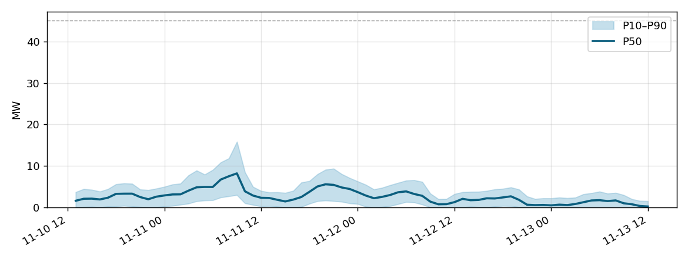

# WindCast Agent — отчёт о прогнозе

- Станция: **Ерейментау ЖЭС** (45.0 MW, Asia/Almaty)
- Время выпуска: 2026-11-10 12:00
- Модель: ensemble
- Верификационный шлюз: пройден

## Итоги (2026-11-10 13:00 – 2026-11-13 13:00)

- Энергия (P50): **188.3 MWh**
- Интервал (P10–P90): 33.8 – 361.5 MWh
- Средняя мощность: 2.62 MW; Коэффициент использования мощности: 5.8%
- Максимум: 8.2 MW (2026-11-11 09:00); Минимум: 0.21 MW (2026-11-13 12:00)

## Периоды слабого ветра (ступица < 4 м/с, ≥ 6 ч)

- 2026-11-12 21:00 – 2026-11-13 05:00 (8 ч, 3.34 m/s)