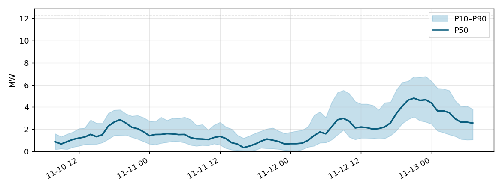

# WindCast Agent — отчёт о прогнозе

- Станция: **Kelmarsh** (12.3 MW, Europe/London)
- Время выпуска: 2026-11-10 07:00
- Модель: ensemble
- Верификационный шлюз: пройден

## Итоги (2026-11-10 08:00 – 2026-11-13 08:00)

- Энергия (P50): **139.1 MWh**
- Интервал (P10–P90): 68.5 – 242.1 MWh
- Средняя мощность: 1.93 MW; Коэффициент использования мощности: 15.7%
- Максимум: 4.8 MW (2026-11-12 21:00); Минимум: 0.34 MW (2026-11-11 16:00)

## Периоды слабого ветра (ступица < 4 м/с, ≥ 6 ч)

- нет

## Качество моделей (тестовый период, 24 ч)

| Model | nMAE, % | Skill | CRPS, % | PICP80, % |
|---|---|---|---|---|
| M6 Ансамбль | 6.36 | 0.691 | 4.97 | 83.7 |
| M2 LightGBM-Q | 6.39 | 0.69 | 4.99 | 82.9 |
| M4 TFT | 6.78 | 0.668 | 5.4 | 79.2 |
| M1 Физикалық | 6.93 | 0.66 | 5.46 | 81.8 |
| M3 LSTM | 7.33 | 0.646 | 5.87 | 75.8 |
| M5 Chronos-Bolt | 18.5 | 0.13 | 14.26 | 76.6 |
| M0 Persistence | 21.71 | 0.0 | 16.65 | 82.6 |